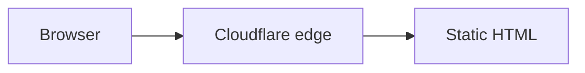

# Authoring guide

Everything on [articles.armenderoian.dev](https://articles.armenderoian.dev) is a Markdown or MDX file in this repository. This guide covers how to write, preview, and publish an article.

## Workflow

1. Create a branch.
2. Add a file under `src/content/articles/` with `draft: true`.
3. Run `npm run dev` and open `http://localhost:4321/articles/<slug>`. Drafts are visible in dev, marked with a banner.
4. When it is ready, set `draft: false`, then run `npm run build` (and optionally `npm run test:integration`) to confirm it validates and its links resolve.
5. Open a pull request. CI runs the full validation. Merging to `main` deploys.

## Files and URLs

| File                                         | URL                       |
| -------------------------------------------- | ------------------------- |
| `src/content/articles/my-article.md`         | `/articles/my-article`    |
| `src/content/articles/my-article.mdx`        | `/articles/my-article`    |
| `src/content/articles/my-article/index.md`   | `/articles/my-article`    |
| `src/content/articles/2026/my-article.md`    | `/articles/my-article`    |
| `src/content/articles/_notes.md` (leading _) | not published, not loaded |

- The slug is the file name, or the folder name for `index.md`/`index.mdx`. Subfolders are only for organisation and never appear in URLs.
- Use a folder (`my-article/index.md`) when an article has its own images, so they live beside it.
- Slugs must be unique. Two files that produce the same slug fail the build.
- **Keep URLs stable.** To rename or move a file without changing its URL, set `slug` in the frontmatter to the old slug.

## Frontmatter

```yaml
---
title: 'Lock-free Queues in C++'
description: How a bounded single-producer, single-consumer queue works, and what the memory orderings are for.
publishedAt: 2026-11-03
category: systems-programming
tags: [c++, concurrency, atomics]
draft: false
---
```

### Required fields

| Field         | Type       | Notes                                                                                  |
| ------------- | ---------- | -------------------------------------------------------------------------------------- |
| `title`       | string     | Up to 120 characters. Quote it if it contains a colon.                                 |
| `description` | string     | Up to 240 characters. Used in listings, search results, RSS, and social/meta tags.     |
| `publishedAt` | date       | `2026-11-03` or a full timestamp such as `2026-11-03T09:30:00Z`. Dates display in UTC. |
| `category`    | string     | One key from `src/data/categories.ts`.                                                 |
| `tags`        | string\[\] | At least one. Normalised to lowercase, whitespace collapsed, duplicates removed.       |
| `draft`       | boolean    | `true` hides the article from production builds entirely (see [Drafts](#drafts)).      |

### Optional fields

| Field           | Type    | Notes                                                                                               |
| --------------- | ------- | --------------------------------------------------------------------------------------------------- |
| `updatedAt`     | date    | Shown as "Updated …" and used for `dateModified` metadata. Must be on or after `publishedAt`.       |
| `coverImage`    | path    | Relative path to an image, e.g. `../../assets/covers/queue.png`. Optimised at build time.           |
| `coverImageAlt` | string  | **Required when `coverImage` is set.** Describe the image; it is also used for social cards.        |
| `series`        | string  | One key from `src/data/series.ts`. Requires `seriesOrder`.                                          |
| `seriesOrder`   | integer | Position in the series, starting at 1. Requires `series`. Must be unique within the series.         |
| `featured`      | boolean | Defaults to `false`. The three newest featured articles appear on the homepage.                     |
| `author`        | string  | Defaults to the site author.                                                                        |
| `canonicalUrl`  | URL     | Absolute `https://` URL, for articles first published elsewhere. Defaults to the article's own URL. |
| `slug`          | string  | Overrides the file-derived slug (lowercase letters, digits, single hyphens).                        |

Unknown fields are rejected, so typos like `publishDate` fail loudly instead of being ignored.

### Validation errors

Frontmatter is validated with Zod when the site builds (and when `npm run dev` or `npm run check` loads content). Errors name the file and every invalid field:

```text
[InvalidContentEntryDataError] articles → my-article data does not match collection schema.

  description: description is required (used for listings and meta tags)
  category: category must be one of "systems-programming", "graphics", "tooling", "site-notes" (defined in src/data/categories.ts)
```

## Categories, tags, and series

- **Categories** are a fixed list in `src/data/categories.ts`, each with a title and description shown on `/categories/<key>`. Add a key there before using it. Every article has exactly one category.
- **Tags** are free-form. Each tag gets a page at `/tags/<tag-slug>`; symbols are spelled out in the URL (`c++` → `/tags/cpp`, `c#` → `/tags/csharp`).
- **Series** are defined in `src/data/series.ts`. Articles in a series are listed on `/series/<key>` and linked with previous/next navigation in `seriesOrder` order, regardless of publication date. Duplicate `seriesOrder` values in one series fail the build.
- **Related articles** at the end of each article are chosen deterministically: two points for sharing the category, one point per shared tag, ties broken by newest first. Articles with nothing in common are never shown as related.

## Writing

Standard Markdown plus GitHub extensions (tables, task lists, strikethrough, footnotes, autolinks) is supported. `src/content/articles/markdown-reference/index.md` shows every element as rendered.

- Start sections at `##`. The page title is the only `h1`. `##`–`###` headings appear in the table of contents, and `##`–`####` headings link to themselves.
- External links get `rel="noopener noreferrer"`, an ↗ marker, and a screen-reader hint automatically.
- Wide tables scroll horizontally inside a keyboard-focusable region.
- Images in Markdown (``) are optimised at build time. Always write meaningful alt text, or `` for purely decorative images.
- Reading time is estimated at 225 words per minute from the article body.

### Code blocks

Code is highlighted at build time by [Expressive Code](https://expressive-code.com/) with VS Code grammars. Every block gets a copy button, scrolls horizontally instead of wrapping, and follows the site theme. Shell languages (`bash`, `sh`, `shell`, `console`, `powershell`) render in a terminal frame.

Options go after the language on the opening fence:

````md
```c title="ring_buffer.c" {5-6}
```

```cpp showLineNumbers
```

```ts title="slug.ts" del={3} ins={4-6}
```

```diff lang="rust" title="src/lib.rs"
-fn old() {}
+fn new() {}
```
````

| Option              | Effect                                             |
| ------------------- | -------------------------------------------------- |
| `title="…"`         | File name or caption in the frame header.          |
| `{2,5-7}`           | Highlight lines.                                   |
| `ins={…}`/`del={…}` | Mark lines as inserted or deleted.                 |
| `showLineNumbers`   | Show line numbers (off by default).                |
| `diff lang="x"`     | Write a unified diff with `x` syntax highlighting. |

Expressive Code also supports text markers (`"needle"`, `/regex/`); see its [documentation](https://expressive-code.com/key-features/text-markers/).

### Math

Write LaTeX between `$…$` (inline) or `$$…$$` (display, on their own lines). Math is typeset by KaTeX during the build; readers download no math JavaScript, and the KaTeX stylesheet is only loaded on pages that contain math. Wide equations scroll horizontally. KaTeX runs with `trust: false`, so commands such as `\href` and `\includegraphics` are disabled.

```md
The dot product is $\mathbf{a} \cdot \mathbf{b} = \lVert \mathbf{a} \rVert \lVert \mathbf{b} \rVert \cos\theta$.

$$
R(\theta) = \begin{bmatrix} \cos\theta & -\sin\theta \\ \sin\theta & \cos\theta \end{bmatrix}
$$
```

### Diagrams

Use a `mermaid` code block. Diagrams are drawn in the browser by [Mermaid](https://mermaid.js.org/), but only on pages that contain one. They follow the site palette and redraw when the theme changes. The source text is kept under each diagram as a collapsible text alternative, and is what readers without JavaScript see.

````md

````

- `title="…"` becomes the visible caption.
- Always add `accTitle` and `accDescr`; they become the SVG's accessible name and description.
- Mermaid runs with `securityLevel: 'strict'`: click handlers and HTML labels are disabled.

### Callouts (MDX)

In `.mdx` files, import the callout component for notes, tips, and warnings:

```mdx
import Callout from '@/components/ui/Callout.astro';

<Callout type="warning" title="Undefined behaviour">
  Signed overflow is undefined in C.
</Callout>
```

`type` is `note` (default), `tip`, or `warning`. `title` defaults to the type name.

### Interactive components (MDX)

Use MDX only when an article needs components. Interactive components are React components in `src/components/interactive/`, hydrated as isolated islands only on the pages that use them. `src/components/interactive/BitExplorer.tsx` is a complete example.

```mdx
import BitExplorer from '@/components/interactive/BitExplorer';

<BitExplorer client:visible initial={42} />
```

Guidelines:

- Prefer `client:visible` so the script loads only when the component scrolls into view. Use `client:load` only for components that are needed immediately.
- The article must still make sense without JavaScript. Explain the idea in prose; the component is an illustration.
- Make components keyboard operable, labelled, and usable at 320px wide. The Playwright suite runs axe on article pages.
- Do not use inline `<script>` tags, `dangerouslySetInnerHTML`, `eval`, or third-party embeds (iframes, remote scripts). The Content-Security-Policy only allows scripts from this site, so they will be blocked in production anyway.
- MDX is executed at build time with full Node access. Only merge MDX you trust.

## Drafts

`draft: true` articles:

- **are** rendered by `npm run dev`, with a "Draft" banner, so you can preview them;
- **are not** in production builds at all: no page, and absent from listings, category/tag/series pages, related articles, RSS, the sitemap, and the search index.

The integration tests verify this against the built site. There is no separate preview deployment; review drafts locally or in a pull request.

## Checklist before publishing

- [ ] `draft: false`, `publishedAt` set, and `updatedAt` added if this is an update.
- [ ] Title and description read well in a listing and a search result.
- [ ] Every image has alt text; the cover has `coverImageAlt`.
- [ ] Diagrams have `accTitle` and `accDescr`.
- [ ] `npm run build && npm run test:integration` pass (validates frontmatter and internal links).
- [ ] If the file was renamed, `slug` preserves the old URL.
