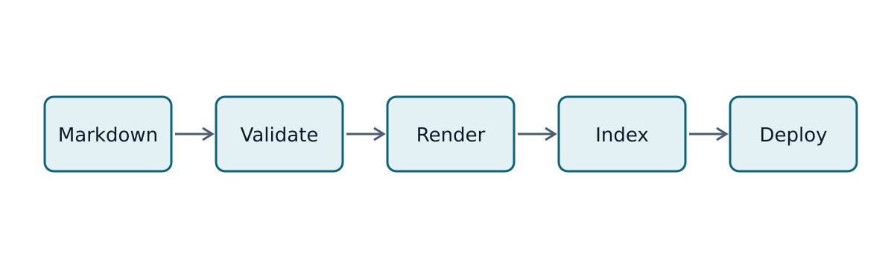

> **Demonstration content.** This page is a rendering reference for the site's Markdown styles.

This article lives in its own folder (`markdown-reference/index.md`) so that its image can sit next to it. Its URL comes from the folder name.

## Text formatting

Paragraphs support **strong emphasis**, _emphasis_, ~~strikethrough~~, `inline code`, and keyboard shortcuts such as <kbd>Ctrl</kbd> + <kbd>K</kbd>. Straight quotes become "curly quotes", and two hyphens become an en dash -- like this.

### Lists

1. Ordered lists keep their numbering.
2. They can contain nested lists:
   - Unordered items use bullets.
   - Nesting works to any depth.
3. And they can continue afterwards.

- [x] Task lists render checkboxes.
- [ ] Unchecked items are shown too.

### Block quotes

> A block quote is set off from the surrounding text with a rule on its left.
>
> It can span multiple paragraphs.

## Tables

Wide tables scroll horizontally inside their own region, so they never widen the page:

| Language   | Typical file extension | Paradigm                         | Memory management       | Typical use in this site's articles |
| ---------- | ---------------------- | -------------------------------- | ----------------------- | ----------------------------------- |
| C          | `.c`, `.h`             | Procedural                       | Manual                  | Low-level examples                  |
| C++        | `.cpp`, `.hpp`         | Multi-paradigm                   | Manual and RAII         | Systems and graphics examples       |
| Rust       | `.rs`                  | Multi-paradigm                   | Ownership and borrowing | Systems examples                    |
| TypeScript | `.ts`                  | Multi-paradigm, statically typed | Garbage collected       | Tooling and web examples            |

## Images

Images placed next to an article are optimized at build time and served in modern formats:

## Footnotes and references

Footnotes collect at the end of the article[^footnotes], and each one links back to where it was referenced[^backlinks]. Links to other sites, like the [CommonMark specification](https://spec.commonmark.org/), are marked as external.

---

Horizontal rules, like the one above, separate sections without adding a heading.

[^footnotes]: Footnotes use the GitHub-flavored Markdown syntax: `[^label]` in the text and `[^label]: text` anywhere in the document.

[^backlinks]: The back-link arrow returns to the reference in the text.
