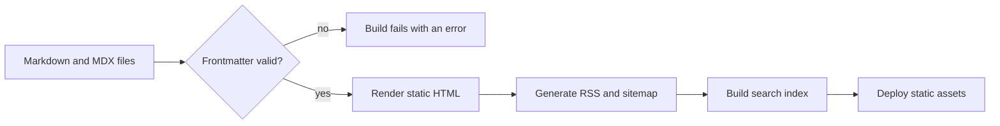
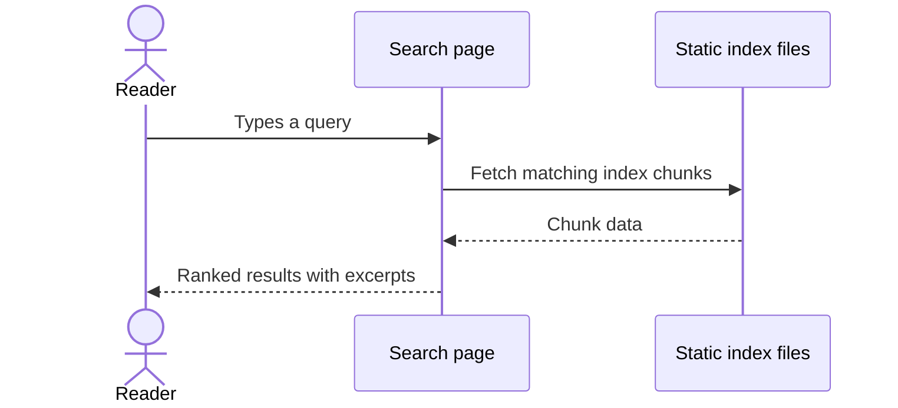

> **Demonstration content.** This article exercises the math and diagram rendering on this site. The equations are standard textbook results.

Part 2 of the tour was published _after_ part 3. Series follow the order the author assigns, not publication dates.

## Inline and display math

Equations are written in standard Markdown math syntax and typeset with [KaTeX](https://katex.org/) at build time, so no math JavaScript runs in the browser. Inline math sits in a sentence: the dot product of $\mathbf{a}$ and $\mathbf{b}$ is $\mathbf{a} \cdot \mathbf{b} = \lVert \mathbf{a} \rVert \lVert \mathbf{b} \rVert \cos\theta$.

Display math gets its own block. A rotation by $\theta$ in the plane:

$$
R(\theta) =
\begin{bmatrix}
\cos\theta & -\sin\theta \\
\sin\theta & \cos\theta
\end{bmatrix}
$$

Linear interpolation between two values, and its derivative with respect to $t$:

$$
\begin{aligned}
\operatorname{lerp}(a, b, t) &= (1 - t)\,a + t\,b \\
\frac{d}{dt}\operatorname{lerp}(a, b, t) &= b - a
\end{aligned}
$$

Long equations scroll horizontally on narrow screens instead of overflowing the page:

$$
\mathbf{M}_{\text{model-view-projection}} = \mathbf{P}\,\mathbf{V}\,\mathbf{M} = \begin{bmatrix} \frac{1}{a \tan(\frac{\phi}{2})} & 0 & 0 & 0 \\ 0 & \frac{1}{\tan(\frac{\phi}{2})} & 0 & 0 \\ 0 & 0 & \frac{f + n}{n - f} & \frac{2fn}{n - f} \\ 0 & 0 & -1 & 0 \end{bmatrix} \mathbf{V}\,\mathbf{M}
$$

## Diagrams

Diagrams are written as [Mermaid](https://mermaid.js.org/) code blocks. They are drawn in the browser, only on pages that contain them, and redrawn when you switch between light and dark themes. The original source stays available under each diagram as a text alternative.

This flowchart shows how this site is built:

A sequence diagram of what happens when you search:

